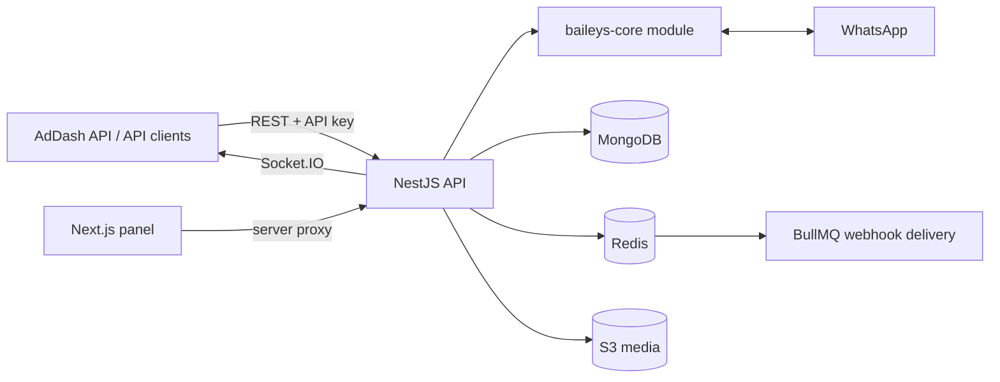

# AdDash WhatsApp API — Multi-tenant WhatsApp Gateway

> Public summary. The source code is private; this repository describes what was built, how, and with which stack.

A multi-tenant REST API for WhatsApp built on Baileys v7, plus a web panel to operate it. It powers report and alert delivery for the [AdDash](https://github.com/eliforte/addash-showcase) platform and exposes almost the whole Baileys surface: messages, chats, groups, communities, newsletters, Business catalog, presence, privacy and calls.

**My role:** Designed and built the API and the management panel end to end.

## Key features

- **Tenancy model** — organizations, then instances, then API keys. Keys are scoped (`messages:send`, `groups:*`, `webhooks:manage`, …), stored only as hashes and shown once on creation.
- **Rate limiting by tier** — separate read / write / send limits per minute, with counters in Redis.
- **Anti-ban protection** — send counters, a warm-up phase for new numbers, and per-instance limits visible in the panel.
- **Signed webhooks** — event delivery through BullMQ queues, with delivery logs, testing and retries.
- **Real time** — QR code, connection status and message events over Socket.IO, with pairing codes as an alternative to the QR.
- **Interactive messages** — buttons, lists and polls.
- **Media** — incoming media uploaded automatically to S3, with on-demand download.
- **Privacy & compliance** — data export and purge (LGPD), audit trail of every authenticated call.
- **Fail-closed docs** — the Scalar / OpenAPI reference returns `404` unless panel credentials are configured, so a misconfigured deploy never exposes the whole surface.

## Management panel

A Next.js panel shows API health (Mongo, Redis, memory), connected instances, sends per day and hour, and anti-ban gauges per instance. It also covers connecting and pairing instances, browsing chats, contacts and groups, managing webhooks, and reading the audit log. The panel's API key lives in an httpOnly cookie and every browser call goes through a server-side proxy, so the key never reaches client JavaScript.

## Architecture

Baileys is isolated in a single `baileys-core` module, the only place that imports the library, so upgrades and protocol changes stay contained.

## Tech stack

| Layer | Technologies |
|---|---|
| Backend | NestJS 11, TypeScript, Baileys v7, Socket.IO, BullMQ |
| Data | MongoDB (Mongoose), Redis, AWS S3 |
| Panel | Next.js 15 (App Router), React, Tailwind CSS v4 |
| Docs & infra | Scalar / OpenAPI, Docker (glibc base image for native dependencies) |
